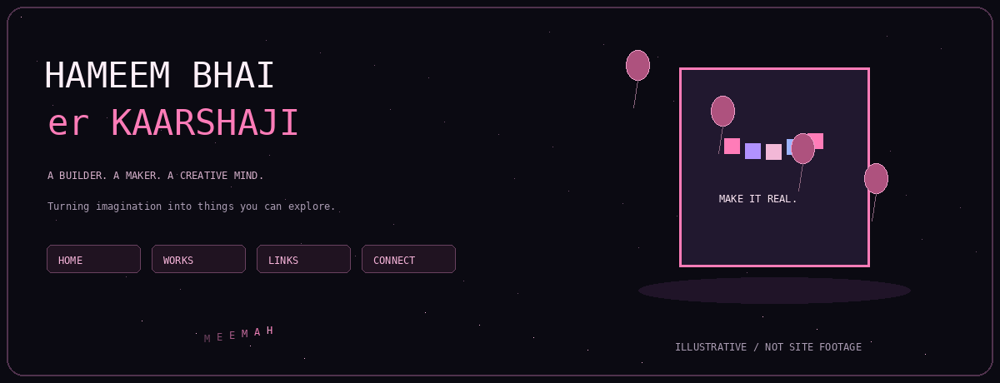

<div align="center">



# Hameem Bhai er Kaarshaji

### Turning imagination into things you can explore.

The source behind my personal portfolio: a visual space for creative work,
interactive experiments, and the ideas I keep turning into real things.

`React 19` · `Vite` · `Three.js` · `React Three Fiber` · `Framer Motion`

[The experience](#more-than-a-list-of-projects) · [Explore](#inside-the-experience) · [Run locally](#run-it-locally) · [Customize](#make-the-content-your-own) · [Deployment](#build-and-deploy)

</div>

---

## More than a list of projects

Hi, I'm Hameem—people know me as Hameem Bhai.

I like making things that have a little personality: websites you can explore,
visuals that hold your attention, and small interactions that make an ordinary
page feel personal.

This portfolio brings that approach together through a floating 3D artwork card,
playful balloon physics, a gallery that changes around the work, and a custom
cursor that leaves my name in motion.

It is a creative frontend project, not a full-stack commerce application or an
account-based platform. The animated README banner is an original illustration
inspired by the source—not a screenshot, recording, or interactive version of the site.

## Inside the experience

| Area | What the source implements |
| :--- | :--- |
| Home | Large personal typography, an introduction, and an animated textured 3D card. |
| Interactive scene | Pink balloon bodies with Rapier physics and a pointer-following collider. |
| Works | A JSON-driven gallery with category filters and animated cards. |
| Atmosphere | Blurred gallery backgrounds update as artwork becomes prominent in view. |
| Image viewing | A click-to-enlarge lightbox with animated entry and exit. |
| Links | A dedicated route for the creator's links. |
| Connect | A contact form with sending, success, and error states. |
| Cursor | A custom `HAMEEM` letter trail following pointer movement. |
| Navigation | Client-side routes for Home, Works, Links, and Connect. |

The hero uses a textured box mesh with subtle motion—not a rigged character model.
The repository includes additional animation-related dependencies; their presence
alone does not mean every library is used throughout the app.

## The route map

| URL | View | Source |
| :--- | :--- | :--- |
| `/` | Landing and interactive scene | `src/pages/Landing.jsx` |
| `/works` | Artwork gallery | `src/pages/Works.jsx` |
| `/links` | Links page | `src/pages/Links.jsx` |
| `/contact` | Contact form | `src/pages/Contact.jsx` |

## Run it locally

Use a supported Node.js version compatible with Vite 8. Current Vite documentation
lists Node.js 20.19+ or 22.12+ as its baseline; prefer a supported LTS release and
follow any stricter dependency-engine requirements reported during installation.

```bash
git clone https://github.com/Hameem-Bhai/my-portfolio.git
cd my-portfolio
npm ci
npm run dev
```

Open the URL printed by Vite, normally http://localhost:5173.

If `npm ci` reports that the manifest and lockfile disagree, inspect the dependency
change rather than replacing the lockfile blindly. Keep both `package.json` and
`package-lock.json` tracked; do not commit `node_modules`.

The 3D scenes need a working WebGL-capable browser/device. Graphics performance,
external environment assets, and motion behavior have not been independently
verified across browsers for this README.

## How it is built

```text
Vite entry / React application
              |
              v
BrowserRouter + shared navigation + cursor
              |
      +-------+---------+--------+
      |                 |        |
Landing / 3D          Works     Links / Contact
      |                 |              |
R3F + Drei          works.json      Web3Forms
Rapier physics      Framer Motion  (configuration needed)
Postprocessing      image assets
```

| Layer | Main tools |
| :--- | :--- |
| UI | React, JSX, CSS, React Router |
| 3D | Three.js, React Three Fiber, Drei |
| Physics | React Three Rapier |
| Scene effects | React Three Postprocessing, ambient occlusion, bloom |
| Interface motion | Framer Motion |
| Build | Vite with the React plugin |
| Contact delivery | Web3Forms request in the contact page |

<details>
<summary>Project structure</summary>

```text
my-portfolio/
├── index.html
├── package.json
├── package-lock.json
├── vite.config.js
├── public/
│   ├── artworks/
│   ├── my_generated_pixel_art.png
│   ├── pixel_avatar.png
│   └── favicon.svg
├── src/
│   ├── main.jsx
│   ├── App.jsx
│   ├── App.css
│   ├── index.css
│   ├── assets/
│   ├── components/
│   │   ├── ArtisticSkills.jsx
│   │   ├── Cursor.jsx
│   │   └── Cursor.css
│   ├── data/
│   │   └── works.json
│   └── pages/
│       ├── Landing.jsx / Landing.css
│       ├── Works.jsx / Works.css
│       ├── Links.jsx / Links.css
│       └── Contact.jsx / Contact.css
└── docs/assets/kaarshaji-banner.gif  # Added by this README pack
```

</details>

## Make the content your own

### Introduction and hero

Edit the copy in `src/pages/Landing.jsx` and the associated page styles.
The 3D artwork card loads `/my_generated_pixel_art.png` from `public/`.
Replace the image while preserving its intended framing, or change the texture
path and mesh dimensions together.

### Artwork gallery

Edit `src/data/works.json`. The gallery reads entries with these fields:

```json
{
  "id": "example-work",
  "title": "Your artwork title",
  "category": "Your category",
  "imageUrl": "/artworks/example.jpg",
  "description": "A short explanation of the idea, process, or outcome."
}
```

This is an example schema, not an included artwork file. Use unique IDs and valid
image paths. Category buttons are derived from the entries, so adding a category
does not require adding another hard-coded filter button.

### Cursor and interactive scene

- `src/components/Cursor.jsx`: letter trail text and movement behavior.
- `src/components/Cursor.css`: cursor appearance.
- `src/components/ArtisticSkills.jsx`: balloon count, physics, lighting, and effects.

Change one visual parameter at a time and test on lower-powered hardware as well
as your own machine.

### Contact form: configuration required

`src/pages/Contact.jsx` currently contains `YOUR_ACCESS_KEY_HERE`. Until replaced
with a valid Web3Forms form access key, the form is not configured for delivery.

Configure it for your own form and test a real submission, success handling, and
failure handling. A Web3Forms browser form key is not the same as a private server
API credential. Never put unrelated secret tokens or private credentials in client
code or `VITE_*` variables: client-side values can be inspected by visitors.

Submitted names, email addresses, and messages go to the external form provider.
Explain that data flow to visitors and review the provider's settings and spam
protection before using the form publicly.

## Build and deploy

```bash
npm run build
npm run preview
```

Vite outputs the static build to `dist` by default. Preview is for checking that
build locally, not a production server.

Deploy the built frontend with a static host that supports SPA routing. Because
this app uses `BrowserRouter`, requests such as `/works` and `/contact` should
serve the application entry point when no real static file matches.

Test direct navigation and refresh on every route—not just navigation from Home.
Subpath hosting also needs attention: the hero uses a root-absolute image path,
and the current Vite config does not define a custom `base`. Adjust asset paths,
Vite base, and router configuration consistently for a project subdirectory.

The repository does not include a verified live URL in this guide. Add a demo link
once you have confirmed the deployed site and deep routes work.

<details>
<summary>Quality checks and improvement priorities</summary>

### Animation lifecycle

The cursor recursively schedules animation frames but stores only the initial
request ID for cancellation. Keep the latest frame ID, cancel it on unmount, and
check for duplicate loops during development/Strict Mode.

### Accessibility

Add reduced-motion behavior, coarse-pointer/touch handling, keyboard access for
opening artwork, accessible lightbox labels and image descriptions, Escape-to-close,
focus trapping, and focus restoration. Connect each contact label to its input.

### Performance and resilience

Measure rather than assume: test multiple Canvas scenes, postprocessing, balloon
physics, pixel ratio, and large gallery images on mobile. Consider lazy-loading,
visibility-based pausing, lower-quality presets, and an accessible fallback when
WebGL or external environment assets are unavailable.

### Tooling

`npm run lint` exists, but no ESLint configuration appeared in the reviewed root
listing. With ESLint 9, verify and add the intended flat config before presenting
lint as a passing quality gate. No dedicated automated test script is declared.

### Presentation

Add real desktop/mobile screenshots and, if useful, a short screen recording.
Keep illustrative banner art clearly separate from actual product captures.

</details>

## Review checklist

- Home renders with the expected texture and lighting.
- Gallery categories filter correctly and backgrounds update.
- Images open and close predictably.
- The interface remains usable with keyboard, touch, and reduced motion.
- Contact delivery is configured and tested.
- A production build loads directly at all four routes.
- No credentials, private contact submissions, or unlicensed artwork are committed.

This README is based on source inspection. No build, browser recording, automated
accessibility audit, or deployment test was performed while preparing it.

## License and artwork

No standalone LICENSE appeared in the reviewed root listing. Add an explicit
license if you want to permit code reuse, and state artwork/branding rights
separately. Public source visibility does not automatically make personal artwork
or brand assets freely reusable.

---

<div align="center">

[Hameem Bhai](https://github.com/Hameem-Bhai)

**More ideas. More experiments. More things worth putting my name on.**

</div>
